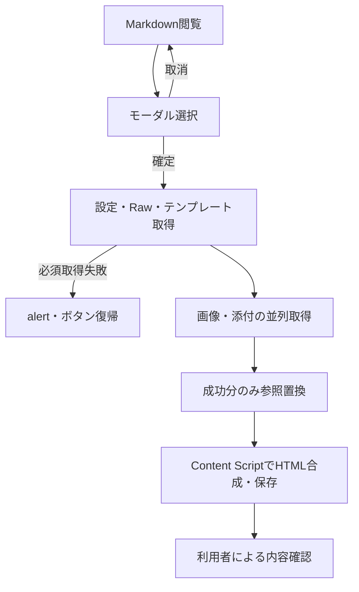

# 業務フロー

## 1. 文書出力（BR-001 / BR-002 / BR-004）
1. 利用者がGitHubの `.md` ファイル画面を開く。Content Scriptは対象DOMがあればボタンを追加する。
2. ボタンクリック時に保存済みeditionを読み、選択モーダルを表示する。
3. キャンセル・Escape・背景クリックなら通信せず終了。確定時に元ボタンを無効化する。
4. Content ScriptがRawリンク・URL情報・プレビュー内添付メタデータを収集し、Service Workerへ依頼する。
5. Service Workerが設定、Raw本文、テンプレートを順番に取得する。本文またはテンプレート取得失敗は全体失敗。
6. 画像・添付を並列取得しBase64化する。個別失敗はwarnを残し、その参照の置換を省略する。
7. 成功した参照をattach:に置換し、データを返す。HTML結合はContent Scriptが行う。
8. Content Scriptがボタンを復帰し、成功時はHTMLを保存、失敗時はalertを表示する。
9. 利用者は出力内容・添付・機密性を確認して共有する。

## 2. 設定（BR-003 / BR-004 / BR-005）
1. Chromeの拡張機能メニューからオプションタブを開き、local設定を反映する。
2. custom選択でURLと接続テストを有効化する。original変更でURLとテスト結果を消去する。
3. 接続テストはtrim後のURLを形式検証し、対象originの権限を確認する。不許可なら要求し、拒否ならfetchしない。
4. 権限ありならHEADし、HTTP成功・非成功・通信例外を表示する。
5. 保存時はcustomの形式を再検証し、3キーを保存する。疎通成功・権限許可は保存前提ではない。
6. 保存コールバックでトーストを表示し1秒後に閉じる。キャンセルは保存せず閉じる。

## 3. 配布（BR-006）
開発者のv*タグpush→Actions checkout→タグを数値・ドットの先頭部分へ正規化→作業領域のmanifest更新→7ファイルをZIP化→公開Releaseへ添付。
この仕様書整備ではタグpush・Release作成は行わない。
