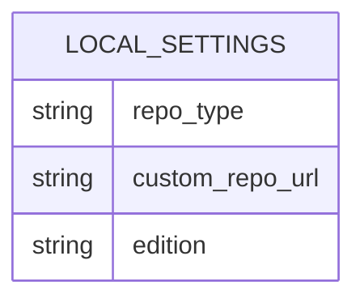
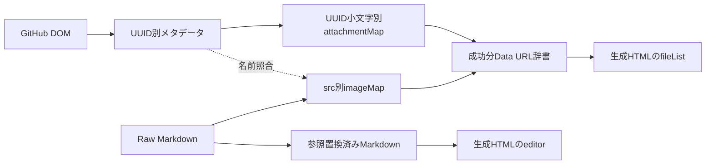

# ER図

## 1. 永続データの論理構造
RDBではなくChrome設定キーを1つの論理集合として表す。以下に主キー・id・リレーションはない。

LOCAL_SETTINGSは説明上の名称であり、storage内にこの名前の親オブジェクトを保存するわけではない。3キーをlocal直下へ保存する。

## 2. 一時データの対応（DBリレーションではない）

UUIDは添付参照とDOMメタデータの照合に使用する。出力HTMLは添付名keyで参照するため、UUIDが異なっても同じkeyなら衝突し得る。参照整合性制約やトランザクションはない。
根拠: options.js chrome.storage.local.set、background.js handleExport、content.js getAttachmentsMetadata。データ項目は22参照。
