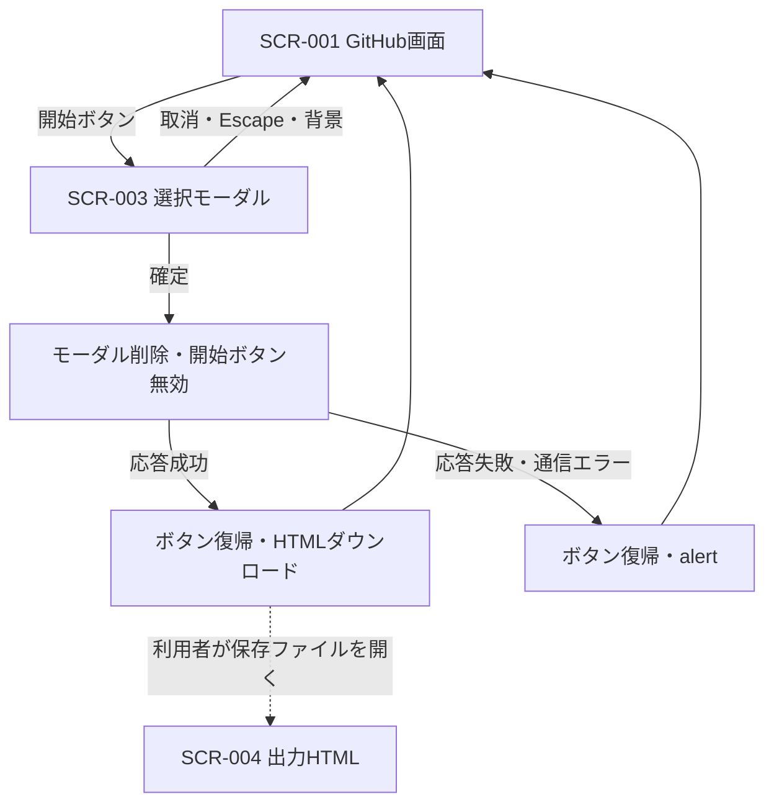
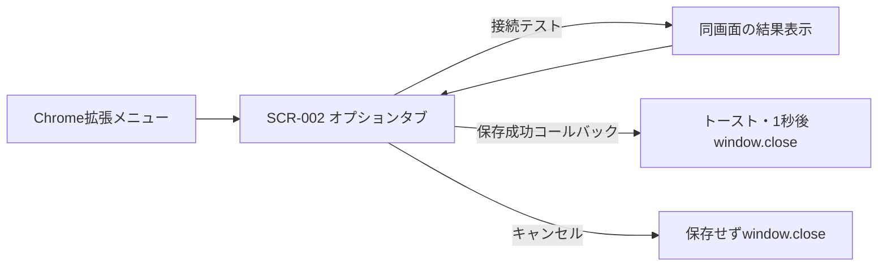

# 画面遷移

## 1. エクスポートの表示状態

モーダル中は元ボタンが有効。実行中のキャンセル・進捗表示はない。HTMLの保存はページ遷移ではなくダウンロード。自動で出力HTMLを開かない。

## 2. 設定画面の独立性

GitHub画面からオプションへの独自リンクはない。window.close後に元GitHubタブへ必ず戻るナビゲーション制御もない。タブ選択はChrome側の挙動。
根拠: content.js handleExportClick / showEditionSelector、options.js保存/取消イベント。
