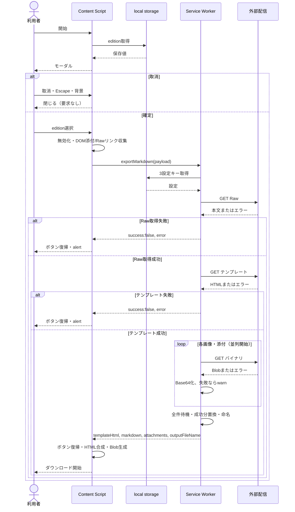
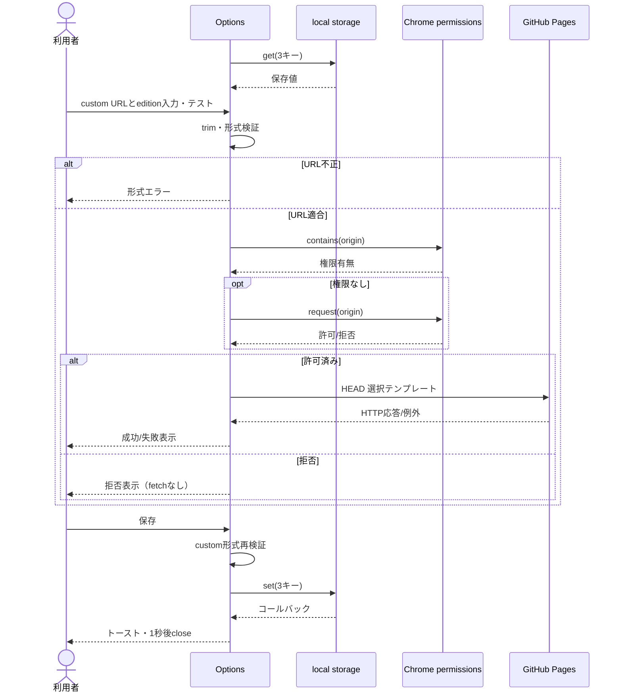
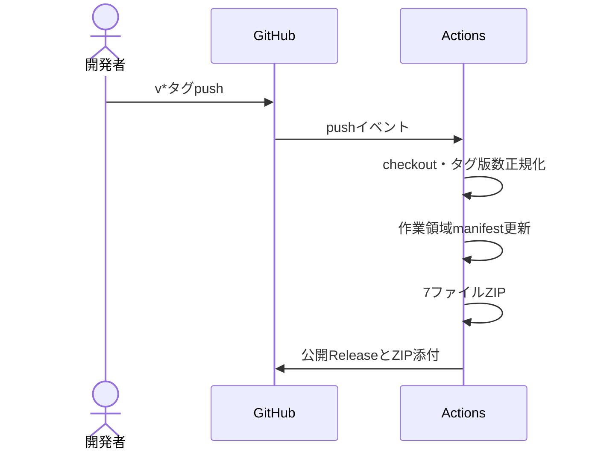

# シーケンス図

## 1. エクスポート（BP-002〜007 / API-001〜003）

Chrome配送失敗はruntime.lastErrorで通知。個別添付失敗は全体成功と両立する。loopは論理的に各取得を表すもので逐次awaitではない。

## 2. 設定・疎通（BP-008）

保存シーケンスは形式検証に成功した場合。接続テストの成功を保存条件にしない。StandardのHEAD先はLIM-01。

## 3. 配布（BP-009）

本仕様書更新作業では上記リリースを実行しない。
