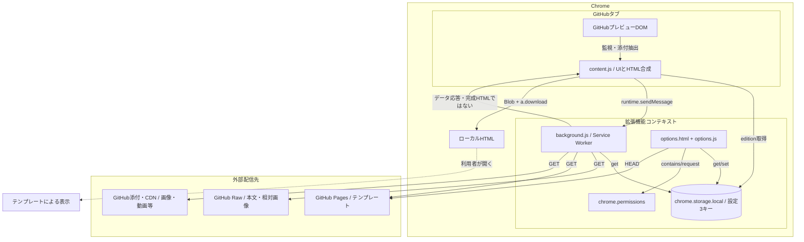
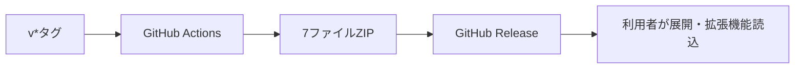

# アーキテクチャ構成図

## 実行構成・通信境界

図は主要取得先。Markdownが指定する外部画像URLもfetch対象になり、権限や配信制約で失敗し得る。
FはMarkdownと成功分の添付を含むファイルで、Chrome storageやGitHubのアクセス権限とは別管理。取得失敗した外部参照やテンプレート内の外部依存は残り得る。

## 配布構成（実行時とは別）

## 設計上の境界
- サーバーアプリ・RDB・API Gateway・JWT認証は存在しない。
- ブラウザ内で変換するが、テンプレート・本文・添付はネットワークから取得する。
- ダウンロードしたテンプレート内のコードの安全性は拡張機能で監査しない。本文エスケープとテンプレート自体の信頼性を混同しない。
- 根拠: manifest.json、content.js、background.js、options.js、release-extension.yml。権限一覧は21、通信契約は32。
