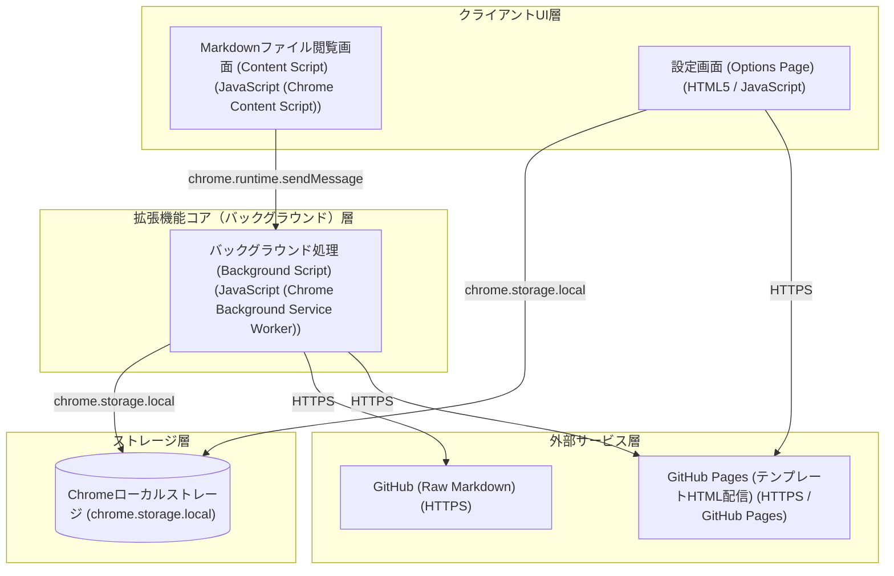

# アーキテクチャ構成図

Google Chrome拡張機能「GitHubMarkDown→かんたんMarkDown」のシステムアーキテクチャ構成図。GitHubのMarkdownファイル閲覧画面上に挿入されたContent Scriptから要求を受け取り、Background Scriptが設定（リポジトリタイプ、カスタムリポジトリURL、エディション）に基づいてRaw MarkdownおよびテンプレートHTMLをフェッチしてエクスポート処理を行います。

**クライアントUI層:**
- Markdownファイル閲覧画面 (Content Script) [JavaScript (Chrome Content Script)]
- 設定画面 (Options Page) [HTML5 / JavaScript]

**拡張機能コア（バックグラウンド）層:**
- バックグラウンド処理 (Background Script) [JavaScript (Chrome Background Service Worker)]

**ストレージ層:**
- Chromeローカルストレージ [chrome.storage.local]

**外部サービス層:**
- GitHub (Raw Markdown) [HTTPS]
- GitHub Pages (テンプレートHTML配信) [HTTPS / GitHub Pages]

**接続:**
- Markdownファイル閲覧画面 (Content Script) → バックグラウンド処理 (Background Script) (chrome.runtime.sendMessage)
- 設定画面 (Options Page) → Chromeローカルストレージ (chrome.storage.local)
- 設定画面 (Options Page) → GitHub Pages (テンプレートHTML配信) (HTTPS)
- バックグラウンド処理 (Background Script) → Chromeローカルストレージ (chrome.storage.local)
- バックグラウンド処理 (Background Script) → GitHub (Raw Markdown) (HTTPS)
- バックグラウンド処理 (Background Script) → GitHub Pages (テンプレートHTML配信) (HTTPS)

