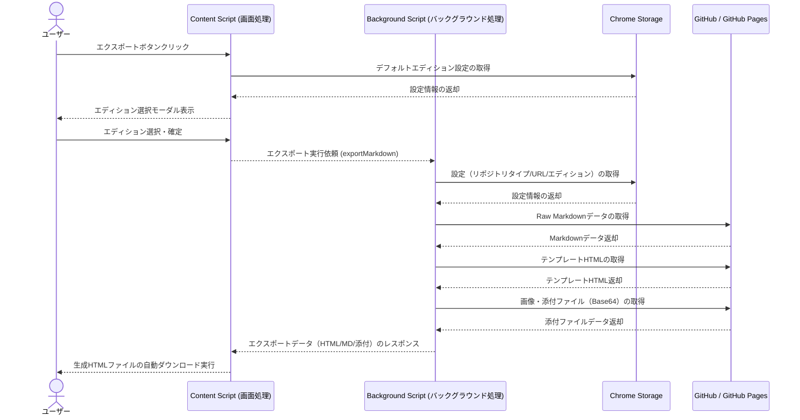
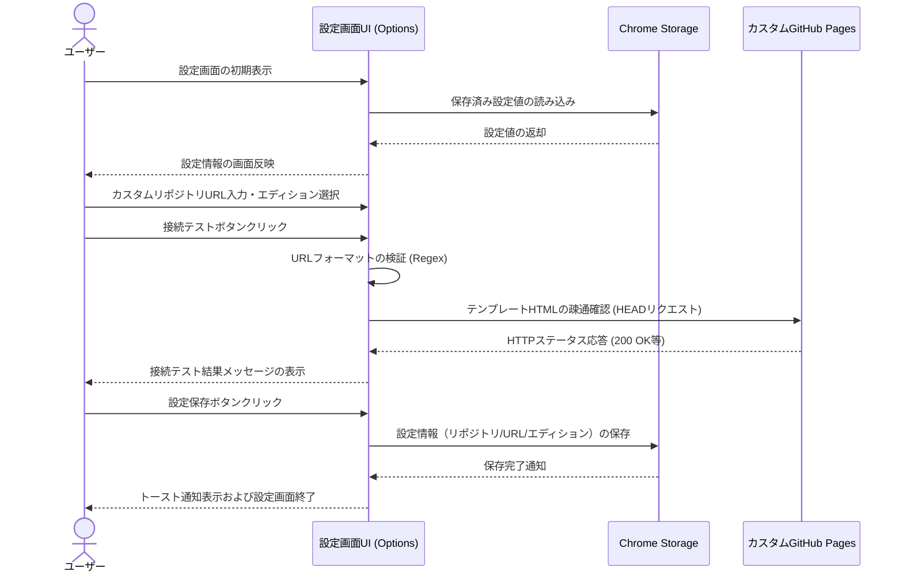

# 業務フロー

## エクスポート機能

GitHub画面上のMarkdownファイルおよび関連データを取り込み、指定されたエディションのテンプレートと合成して「かんたんMarkdown」HTMLとしてエクスポートする業務フロー

**参加者:** ユーザー (actor)、Content Script (画面処理) (system)、Background Script (バックグラウンド処理) (system)、Chrome Storage (database)、GitHub / GitHub Pages (external)

**メッセージフロー:**
- ユーザー → Content Script (画面処理): エクスポートボタンクリック
- Content Script (画面処理) → Chrome Storage: デフォルトエディション設定の取得
  - Chrome Storage ← Content Script (画面処理): 設定情報の返却
  - Content Script (画面処理) ← ユーザー: エディション選択モーダル表示
- ユーザー → Content Script (画面処理): エディション選択・確定
- Content Script (画面処理) → Background Script (バックグラウンド処理): エクスポート実行依頼 (exportMarkdown)
- Background Script (バックグラウンド処理) → Chrome Storage: 設定（リポジトリタイプ/URL/エディション）の取得
  - Chrome Storage ← Background Script (バックグラウンド処理): 設定情報の返却
- Background Script (バックグラウンド処理) → GitHub / GitHub Pages: Raw Markdownデータの取得
  - GitHub / GitHub Pages ← Background Script (バックグラウンド処理): Markdownデータ返却
- Background Script (バックグラウンド処理) → GitHub / GitHub Pages: テンプレートHTMLの取得
  - GitHub / GitHub Pages ← Background Script (バックグラウンド処理): テンプレートHTML返却
- Background Script (バックグラウンド処理) → GitHub / GitHub Pages: 画像・添付ファイル（Base64）の取得
  - GitHub / GitHub Pages ← Background Script (バックグラウンド処理): 添付ファイルデータ返却
  - Background Script (バックグラウンド処理) ← Content Script (画面処理): エクスポートデータ（HTML/MD/添付）のレスポンス
  - Content Script (画面処理) ← ユーザー: 生成HTMLファイルの自動ダウンロード実行

## 設定管理

エクスポートに使用するテンプレートリポジトリタイプやエディションの設定・保存およびカスタムリポジトリURLの接続検証を行う業務フロー

**参加者:** ユーザー (actor)、設定画面UI (Options) (system)、Chrome Storage (database)、カスタムGitHub Pages (external)

**メッセージフロー:**
- ユーザー → 設定画面UI (Options): 設定画面の初期表示
- 設定画面UI (Options) → Chrome Storage: 保存済み設定値の読み込み
  - Chrome Storage ← 設定画面UI (Options): 設定値の返却
  - 設定画面UI (Options) ← ユーザー: 設定情報の画面反映
- ユーザー → 設定画面UI (Options): カスタムリポジトリURL入力・エディション選択
- ユーザー → 設定画面UI (Options): 接続テストボタンクリック
- 設定画面UI (Options) → 設定画面UI (Options): URLフォーマットの検証 (Regex)
- 設定画面UI (Options) → カスタムGitHub Pages: テンプレートHTMLの疎通確認 (HEADリクエスト)
  - カスタムGitHub Pages ← 設定画面UI (Options): HTTPステータス応答 (200 OK等)
  - 設定画面UI (Options) ← ユーザー: 接続テスト結果メッセージの表示
- ユーザー → 設定画面UI (Options): 設定保存ボタンクリック
- 設定画面UI (Options) → Chrome Storage: 設定情報（リポジトリ/URL/エディション）の保存
  - Chrome Storage ← 設定画面UI (Options): 保存完了通知
  - 設定画面UI (Options) ← ユーザー: トースト通知表示および設定画面終了

