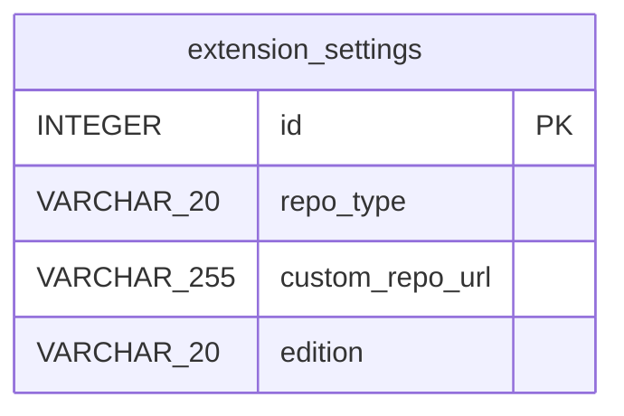

# ER図

GitHubtoKanTanMDExport拡張機能で使用されるchrome.storage.local内の設定データ構造を示すER図。データベースは存在せず、設定情報のみを保持します。

### エンティティ一覧

**SETTINGS**

| カラム名 | データ型 | キー |
| --- | --- | --- |
| id | INTEGER | PK |
| repo_type | VARCHAR(20) |  |
| custom_repo_url | VARCHAR(255) |  |
| edition | VARCHAR(20) |  |

### ER図

