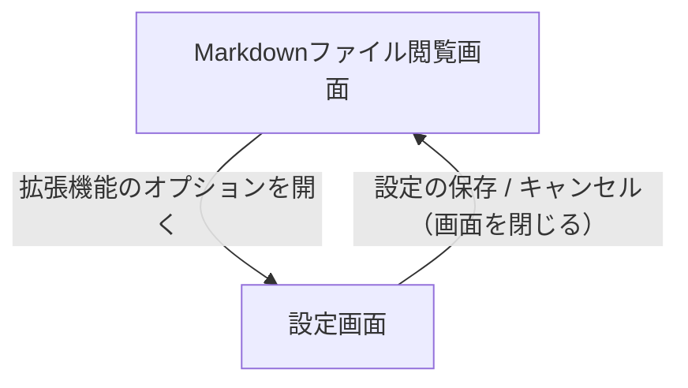

# 画面遷移

GitHub上のMarkdownファイル閲覧画面と、拡張機能の設定画面（options.html）間の遷移図です。ユーザーは拡張機能のオプションから設定画面へ遷移し、リポジトリタイプやエディションなどの設定変更を行って保存・適用します。

**フロー:**
- Markdownファイル閲覧画面 → 設定画面 (拡張機能のオプションを開く)
- 設定画面 → Markdownファイル閲覧画面 (設定の保存 / キャンセル（画面を閉じる）)

