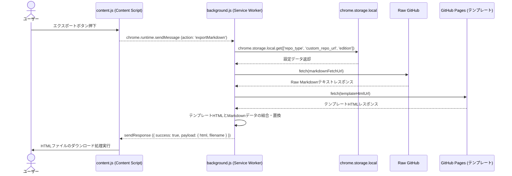
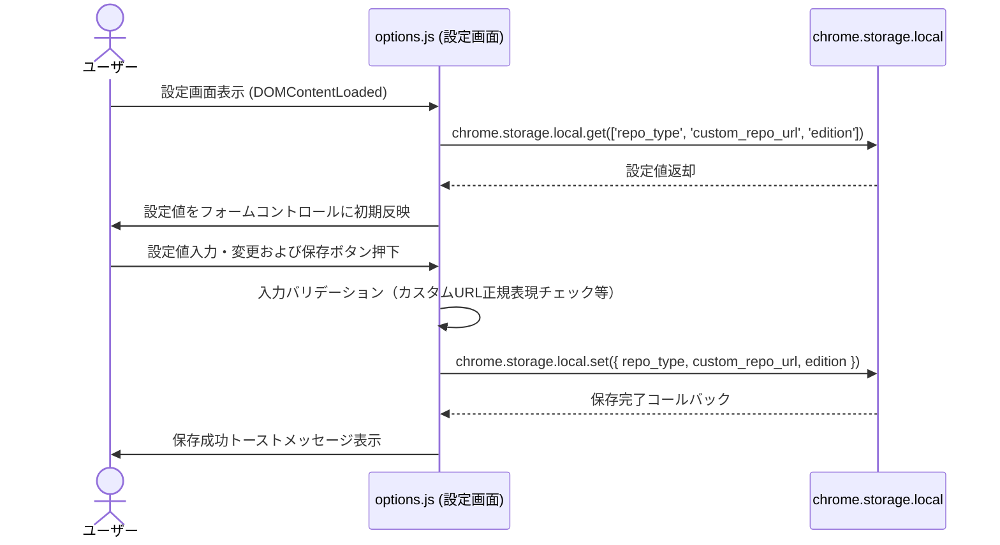
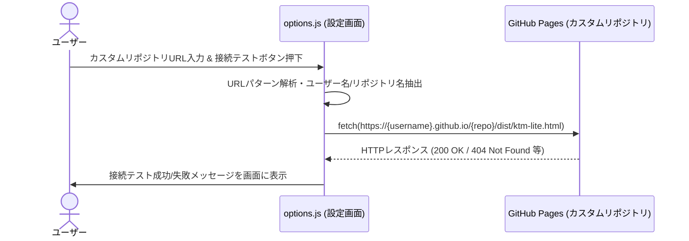
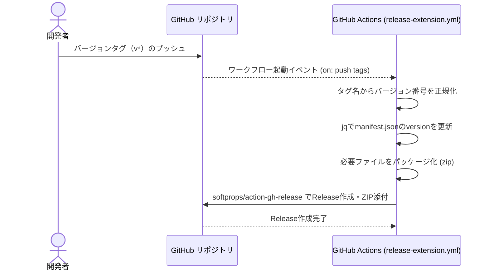

# シーケンス図

## エクスポート処理

Markdown閲覧画面からエクスポートボタンを押下し、Raw MarkdownおよびテンプレートHTMLをフェッチ・結合してエクスポート用HTMLを生成・保存するフロー。

**参加者:** ユーザー (actor)、content.js (Content Script) (system)、background.js (Service Worker) (system)、chrome.storage.local (database)、Raw GitHub (system)、GitHub Pages (テンプレート) (system)

**メッセージフロー:**
- ユーザー → content.js (Content Script): エクスポートボタン押下
- content.js (Content Script) → background.js (Service Worker): chrome.runtime.sendMessage (action: 'exportMarkdown')
- background.js (Service Worker) → chrome.storage.local: chrome.storage.local.get(['repo_type', 'custom_repo_url', 'edition'])
  - chrome.storage.local ← background.js (Service Worker): 設定データ返却
- background.js (Service Worker) → Raw GitHub: fetch(markdownFetchUrl)
  - Raw GitHub ← background.js (Service Worker): Raw Markdownテキストレスポンス
- background.js (Service Worker) → GitHub Pages (テンプレート): fetch(templateHtmlUrl)
  - GitHub Pages (テンプレート) ← background.js (Service Worker): テンプレートHTMLレスポンス
- background.js (Service Worker) → background.js (Service Worker): テンプレートHTMLとMarkdownデータの結合・置換
  - background.js (Service Worker) ← content.js (Content Script): sendResponse ({ success: true, payload: { html, filename } })
- content.js (Content Script) → ユーザー: HTMLファイルのダウンロード処理実行

## 設定管理

設定画面の初期化時にローカルストレージから設定を取得し、画面で変更された内容（リポジトリタイプ、カスタムリポジトリURL、エディション）をバリデーションのうえ永続化保存するフロー。

**参加者:** ユーザー (actor)、options.js (設定画面) (system)、chrome.storage.local (database)

**メッセージフロー:**
- ユーザー → options.js (設定画面): 設定画面表示 (DOMContentLoaded)
- options.js (設定画面) → chrome.storage.local: chrome.storage.local.get(['repo_type', 'custom_repo_url', 'edition'])
  - chrome.storage.local ← options.js (設定画面): 設定値返却
- options.js (設定画面) → ユーザー: 設定値をフォームコントロールに初期反映
- ユーザー → options.js (設定画面): 設定値入力・変更および保存ボタン押下
- options.js (設定画面) → options.js (設定画面): 入力バリデーション（カスタムURL正規表現チェック等）
- options.js (設定画面) → chrome.storage.local: chrome.storage.local.set({ repo_type, custom_repo_url, edition })
  - chrome.storage.local ← options.js (設定画面): 保存完了コールバック
- options.js (設定画面) → ユーザー: 保存成功トーストメッセージ表示

## 設定管理

設定画面に入力されたカスタムリポジトリURLからGitHub PagesのテンプレートURLを構築し、接続テストを実施するフロー。

**参加者:** ユーザー (actor)、options.js (設定画面) (system)、GitHub Pages (カスタムリポジトリ) (system)

**メッセージフロー:**
- ユーザー → options.js (設定画面): カスタムリポジトリURL入力 & 接続テストボタン押下
- options.js (設定画面) → options.js (設定画面): URLパターン解析・ユーザー名/リポジトリ名抽出
- options.js (設定画面) → GitHub Pages (カスタムリポジトリ): fetch(https://{username}.github.io/{repo}/dist/ktm-lite.html)
  - GitHub Pages (カスタムリポジトリ) ← options.js (設定画面): HTTPレスポンス (200 OK / 404 Not Found 等)
- options.js (設定画面) → ユーザー: 接続テスト成功/失敗メッセージを画面に表示

## CI/CD

バージョンタグのプッシュを検知してGitHub Actionsが起動し、manifest.jsonのバージョン更新、ZIP化、およびGitHub Releaseの作成を自動実行するフロー。

**参加者:** 開発者 (actor)、GitHub リポジトリ (system)、GitHub Actions (release-extension.yml) (system)

**メッセージフロー:**
- 開発者 → GitHub リポジトリ: バージョンタグ（v*）のプッシュ
- GitHub リポジトリ → GitHub Actions (release-extension.yml): ワークフロー起動イベント (on: push tags)
- GitHub Actions (release-extension.yml) → GitHub Actions (release-extension.yml): タグ名からバージョン番号を正規化
- GitHub Actions (release-extension.yml) → GitHub Actions (release-extension.yml): jqでmanifest.jsonのversionを更新
- GitHub Actions (release-extension.yml) → GitHub Actions (release-extension.yml): 必要ファイルをパッケージ化 (zip)
- GitHub Actions (release-extension.yml) → GitHub リポジトリ: softprops/action-gh-release でRelease作成・ZIP添付
  - GitHub リポジトリ ← GitHub Actions (release-extension.yml): Release作成完了

